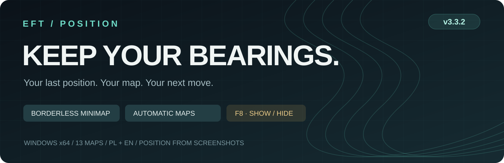
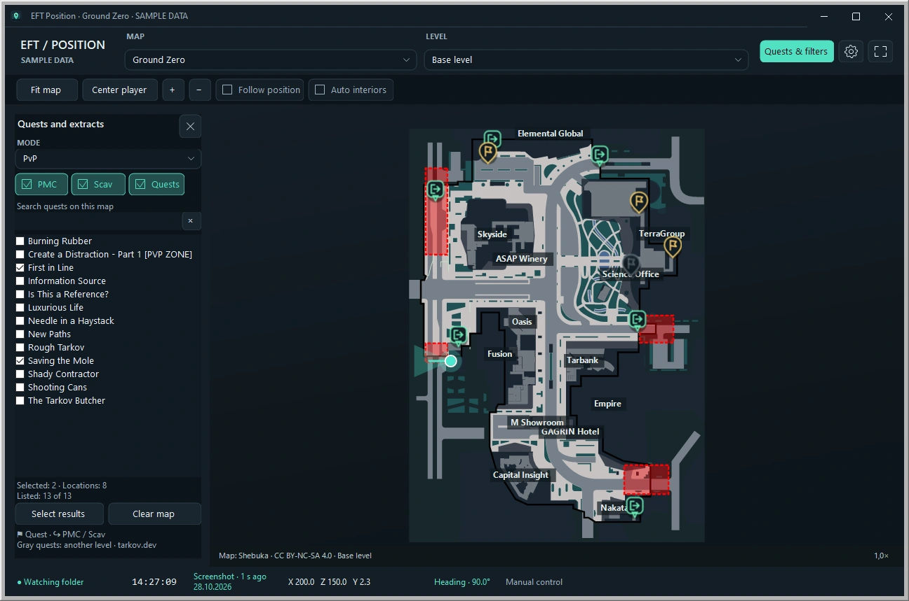
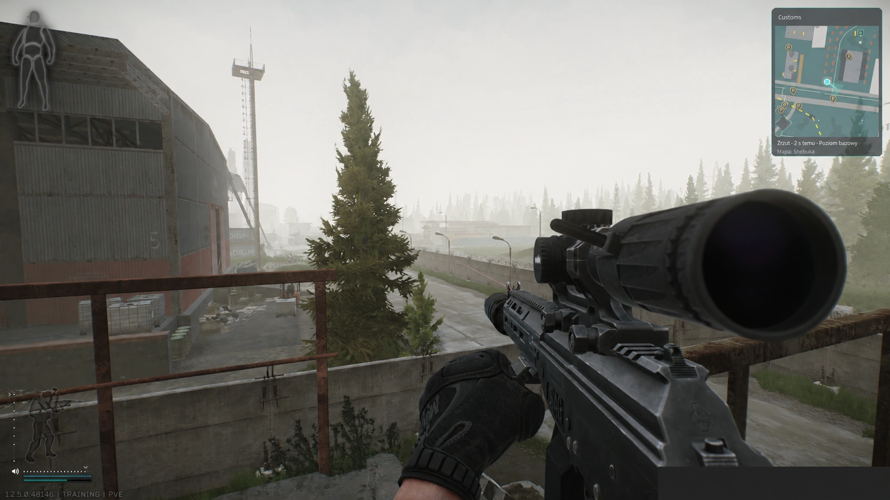
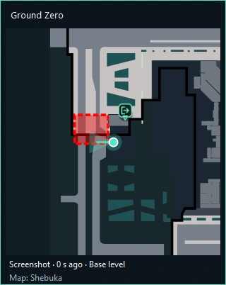
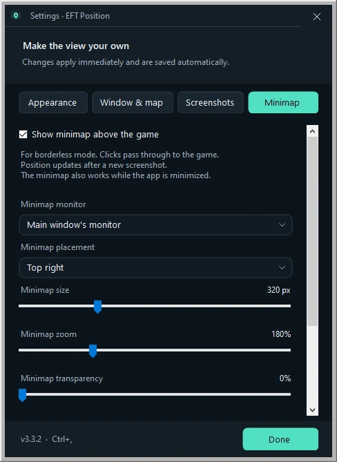

# EFT Position 3.3.2

**[Download for Windows](https://github.com/Joluette/EFT-Map/releases/tag/3.3.2)** · [What's new](RELEASE-NOTES.md) · [English](#english) · [Polski](#polski)

## English

Know where your last screenshot puts you. EFT Position is a small Windows map companion for Escape from Tarkov, with a borderless minimap, automatic map selection, quest locations and extract names.

**New since 3.2:** an in-game minimap for borderless mode, automatic map switching from local game logs, and **F8** to show or hide the minimap. Version 3.3.2 fixes real scene names such as **Shopping_Mall → Interchange**.

### Get started

1. Download **EFT-Position-Windows-3.3.2.zip** from the [release](https://github.com/Joluette/EFT-Map/releases/tag/3.3.2). Extract the whole folder and run **EftPosition.exe** or **Uruchom.cmd**. Keep `assets`, `lib` and `EftPosition.exe.config` beside the app.
2. For English, open the gear button → **Wygląd → Język / Language → English (EN)**.
3. In **Settings → Screenshots**, select EFT's screenshot folder, usually `Documents\Escape from Tarkov\Screenshots`.
4. In **Settings → Window & map**, enable **Automatically switch maps from game logs**. Use **Detect folder** or select the game's `Logs` folder. BSG and Steam installations are supported, including Steam's `build\Logs`.
5. For the overlay, use borderless mode in EFT and enable **Settings → Minimap → Show minimap above the game**. Press **F8** to show or hide it.
6. Take a screenshot using the game's screenshot feature. The app reads the position and heading from its filename.

**Position updates after each new screenshot. It does not track movement between screenshots.** Map selection comes from the game's application logs and can happen while the raid loads. You can also select a map manually.

Requires Windows x64 and .NET Framework 4.8. Extract to a writable folder so settings and downloaded maps can be saved. **Przyklad.cmd** opens a sample-data preview without starting EFT.

### Map, quests and extracts

- **13 maps and 55 levels**, with automatic interior/level selection after a screenshot.
- Selected quest locations, PMC/Scav extracts, and names when you hover over their icons.
- Search quest names in English or Polish, select multiple quests, and keep your choices between sessions.
- PvP, PvE and Seasonal PvP datasets. Quest pins on another recognized level are dimmed.
- Zoom, pan, fit the map, center the player, and follow the latest screenshot position.
- Polish and English interfaces, themes, accent colors, background options, transparency and marker sizes.

Some map layers download on first use and then use a local cache. Quest and extract locations are bundled; the included Terminal dataset has no quest/extract points. Markers show known locations, not whether an extract is available in your current raid.

### Icon legend

| Icon | Meaning |
| --- | --- |
|  | **Your latest position** — turquoise dot with a white ring, read from the last screenshot. |
|  | **Viewing direction** — line and translucent cone from the same screenshot. |
|  | **Older position** — the player marker turns amber after 30 seconds without a new screenshot. |
|  | **Selected quest location** — gold flag pin; the small flag can resemble the letter P. A quest can have several pins. |
|  | **PMC extract** — green exit arrow in a rounded square badge. Also used for shared extracts with the PMC filter enabled. |
|  | **Scav extract** — blue exit arrow in a circular badge. Shared extracts use this badge when only the Scav filter is enabled. |
|  | **Quest on another recognized floor** — gray/dimmed quest pin. It does not indicate quest completion. |
|   | **Shared PMC/Scav extract** — uses one of the two extract badges according to the filters; it has no separate icon. |

Hover quest or extract icons on the main map to see their names. Extract availability still needs to be checked in game. This legend covers markers added by EFT Position; symbols printed in the map artwork vary by map.

### Borderless minimap

*Gameplay capture supplied by the project author; Polish interface. The notification containing a private local path was redacted.*

| Minimap with sample position | Minimap settings |
| --- | --- |
|  |  |

The minimap stays above other windows and remains visible when the main app is minimized. Clicks pass through it while locked. In positioning mode, drag the window or its bottom right corner, then click **✓** to lock it.

Choose the monitor, corner or custom position, size, zoom and transparency. These choices are remembered. It is a normal Windows overlay intended for **borderless/windowed play**.

The interface previews use **sample data**. The gameplay capture above was supplied by the project author.

### Controls

| Shortcut / action | Result |
| --- | --- |
| **F8** | Show / hide minimap |
| **Ctrl+Alt+M** | Alternative minimap toggle, if available |
| **Ctrl+Alt+Shift+M** | Enter / leave minimap positioning mode |
| **Ctrl+,** | Settings |
| **Ctrl+F** | Quest and extract filters |
| **F11**, then **Esc / F11** | Full-screen map / return |
| **F10** | Restore full window visibility |
| Mouse wheel / **+ / −** | Zoom |
| Drag / **Fit map** / **Center player** | Adjust the map view |

If a global shortcut is already used by another program, its status appears in **Settings → Minimap**. The app retries registration after it becomes free. The settings buttons remain available.

### Screenshots, logs and updating

**Delete screenshot after reading is enabled by default.** A recognized PNG is deleted only after its position is shown on the main map or visible minimap. Disable this in **Settings → Screenshots** to keep it. The app does not clear your screenshot archive; unrecognized, changed or undisplayed files are retained.

Coordinates and heading come from screenshot filenames. Automatic map selection reads local `application.log` / `application_*.log` files. The app does not read game memory, inject code, or upload your screenshots or log contents.

When updating, close the app and extract the new package while **keeping your existing `cache` folder**. It contains settings, quest choices and downloaded maps. Automatic map selection and the minimap can be enabled in settings after upgrading; older preferences keep their existing choices.

### Community and support

Found a bug or have an idea? Use the [issue forms](https://github.com/Joluette/EFT-Map/issues/new/choose). Reports in English and Polish are welcome. See [contributing](CONTRIBUTING.md), our [code of conduct](CODE_OF_CONDUCT.md), [accessibility notes](ACCESSIBILITY.md), and the [security reporting policy](SECURITY.md).

### Build and verification

Download **EFT-Map-kod-zrodlowy-3.3.2.zip** or use this repository. **Zbuduj.cmd** builds the C#/WinForms application; **Testuj.cmd** runs the tests. The .NET Framework compiler and bundled `lib` libraries are sufficient. Some UI checks need a Windows desktop session.

See [RAPORT.md](RAPORT.md) for validation scope and [RELEASE-NOTES.md](RELEASE-NOTES.md) for changes. The release includes **SHA256SUMS.txt**. The Windows ZIP contains `BUILD-INFO.json` with the executable hash and source revision.

### Credits

Map artwork: **Shebuka**, [CC BY-NC-SA 4.0](https://creativecommons.org/licenses/by-nc-sa/4.0/). Map data/calibration and quest/extract locations: [tarkov.dev](https://tarkov.dev). Application code: **GPL-3.0-only**. SharpVectors 1.8.5: **BSD-3-Clause** with bundled component notices.

The optional Tarkov and Tarkov × Cyberpunk backgrounds were generated with AI from references; they are not official artwork or confirmation of a brand collaboration. The documentation images use the application's plain background.

Full sources, attribution and license texts: [THIRD-PARTY-NOTICES.md](THIRD-PARTY-NOTICES.md), `licenses`, `lib/dependencies.json` and [image credits](docs/images/README.md). Escape from Tarkov belongs to Battlestate Games; this is an independent community project.

---

## Polski

EFT Position pokazuje pozycję i kierunek z ostatniego screenshota z Tarkova. Wersja **3.3.2** dodaje względem publicznej 3.2 minimapę nad grą, automatyczny wybór mapy z logów i skrót **F8**. Naprawia też rozpoznawanie scen Interchange, Factory, Reserve i Streets.

### Legenda ikon

| Ikona | Znaczenie |
| --- | --- |
|  | **Twoja ostatnia pozycja** — turkusowa kropka z białą obwódką, odczytana ze screenshota. |
|  | **Kierunek patrzenia** — kreska i półprzezroczysty stożek z tego samego zrzutu. |
|  | **Starsza pozycja** — znacznik zmienia kolor na bursztynowy po 30 sekundach bez nowego zrzutu. |
|  | **Lokalizacja wybranego questu** — złota pinezka z flagą, która może wyglądać jak litera P. Quest może mieć kilka punktów. |
|  | **Ekstrakt PMC** — zielona strzałka wyjścia w zaokrąglonym kwadracie; obejmuje też wspólne wyjścia przy włączonym filtrze PMC. |
|  | **Ekstrakt Scav** — niebieska strzałka w okrągłej odznace; wspólne wyjścia dostają ją przy włączonym samym filtrze Scav. |
|  | **Quest na innym rozpoznanym piętrze** — szara/przygaszona pinezka; nie oznacza ukończenia questu. |
|   | **Wspólny ekstrakt PMC/Scav** — korzysta z jednej z tych dwóch ikon zależnie od filtrów, bez osobnego symbolu. |

Nazwę questu lub ekstraktu zobaczysz po najechaniu na ikonę na głównej mapie. Dostępność wyjścia sprawdzaj w grze. Symbole narysowane w samym podkładzie mapy mogą różnić się między mapami.

### Uruchomienie

1. Pobierz [EFT-Position-Windows-3.3.2.zip](https://github.com/Joluette/EFT-Map/releases/tag/3.3.2), rozpakuj cały folder i uruchom **EftPosition.exe**. Zachowaj `assets`, `lib` i `EftPosition.exe.config`.
2. W **Ustawienia → Zrzuty** wybierz folder screenshotów EFT.
3. W **Ustawienia → Okno i mapa** włącz **Automatycznie przełączaj mapę z logów gry**. Użyj **Wykryj folder** lub wskaż folder `Logs` w instalacji gry.
4. W EFT wybierz tryb bez ramek. W **Ustawienia → Minimapa** włącz nakładkę i dopasuj jej wygląd.
5. Zrób screenshot w grze. **F8** pokazuje/ukrywa minimapę, a **Ctrl+Alt+Shift+M** włącza ustawianie jej położenia i rozmiaru. **✓** ponownie blokuje minimapę.

Mapa może zmienić się już podczas ładowania lokacji. **Pozycja odświeża się po screenshocie; pomiędzy zrzutami nie ma ciągłego śledzenia.** Wybór mapy ręcznie pozostaje dostępny.

Program ma 13 map i 55 poziomów, automatyczne piętra/wnętrza, questy, ekstrakty z nazwami po najechaniu oraz interfejs PL/EN. Minimapa pozostaje widoczna po zminimalizowaniu głównego okna; w trybie zablokowanym kliknięcia przechodzą do gry. Część map pobiera się przy pierwszym wczytaniu.

**Usuwanie rozpoznanego zrzutu po pokazaniu pozycji jest domyślnie włączone.** Możesz je wyłączyć w ustawieniach zrzutów. Aplikacja nie czyści całego archiwum. Przy aktualizacji zachowaj swój folder **cache**, aby utrzymać ustawienia, questy i pobrane mapy.

Wymagane: Windows x64 i .NET Framework 4.8. **Przyklad.cmd** pokazuje dane przykładowe, **Zbuduj.cmd** buduje kod, a **Testuj.cmd** uruchamia testy. Powyżej są podglądy interfejsu z danymi przykładowymi oraz dostarczony przez autora zrzut z gry. [Patch notes](RELEASE-NOTES.md) są najpierw po angielsku, z polskim podsumowaniem.

### Zgłoszenia i współpraca

Błędy i pomysły możesz zgłaszać [po polsku lub angielsku](https://github.com/Joluette/EFT-Map/issues/new/choose). Zasady i instrukcje: [Contributing](CONTRIBUTING.md), [Code of conduct](CODE_OF_CONDUCT.md), [dostępność](ACCESSIBILITY.md), [zgłoszenia bezpieczeństwa](SECURITY.md).
