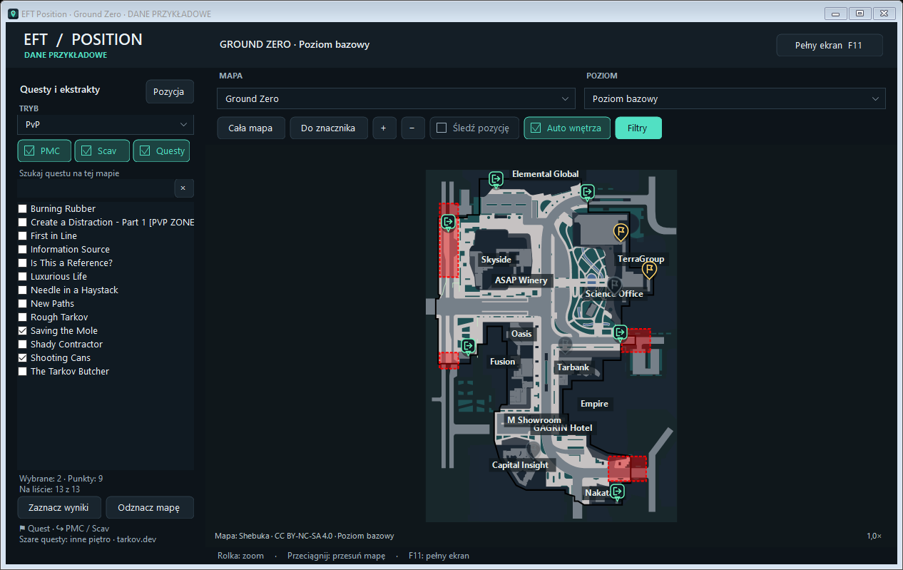

# EFT Position 3.1.0

Mała apka do Tarkova, która pokazuje, gdzie jesteś na mapie. Wybierasz lokację, robisz screena w grze i pojawia się znacznik Twojej pozycji oraz kierunku patrzenia. Kolejny screen odświeża pozycję.

Współrzędne są odczytywane z nazwy pliku. Program nie czyta pamięci ani logów gry.

## Pobieranie

**[Pobierz wersję 3.1.0](https://github.com/Joluette/EFT-Map/releases/tag/3.1.0)**

1. W sekcji **Assets** wybierz **EFT-Position-Windows-3.1.0.zip**.
2. Rozpakuj cały folder i uruchom **EftPosition.exe** albo **Uruchom.cmd**. Zostaw obok programu foldery `assets`, `lib` i plik `EftPosition.exe.config`.
3. Wybierz mapę i folder, w którym EFT zapisuje screenshoty. Zwykle jest to `Dokumenty\Escape from Tarkov\Screenshots`.
4. Zrób screena funkcją gry — pozycja powinna pojawić się na mapie.

Potrzebujesz Windowsa 64-bit z .NET Framework 4.8. Rozpakuj aplikację np. do Dokumentów, żeby mogła zapisywać ustawienia. Folder zrzutów zostanie zapamiętany na następne uruchomienie.

Jeśli chcesz najpierw zobaczyć, jak to wygląda, odpal **Przyklad.cmd**. Działa bez włączania Tarkova. To nadal wersja testowa; starsza [3.0.0](https://github.com/Joluette/EFT-Map/releases/tag/3.0.0) też jest dostępna.

## Mapa i questy

Do wyboru jest 13 map i 55 poziomów. Mapę ustawiasz ręcznie. **Auto wnętrza** próbuje dopasować piętro i zbliżenie po nowym zrzucie; poziom zawsze możesz też wybrać samodzielnie. Część map i pięter potrzebuje internetu przy pierwszym pobraniu, potem korzysta z zapisanej kopii.

Pod **Filtry** znajdziesz ekstrakty PMC/Scav i questy. Możesz wyszukać nazwę po polsku lub angielsku, bez polskich znaków, i zaznaczyć kilka zadań naraz. Lista dotyczy tylko wybranej mapy i trybu: PvP, PvE albo PvP sezonowego. Zmiana wyszukiwania nie kasuje zaznaczeń, a wybór zostaje zapisany na później.

Złote pinezki z flagą to miejsca questowe, zielone i niebieskie znaczki to wyjścia. Najedź kursorem, żeby zobaczyć nazwę. Questy na innym rozpoznanym piętrze są przyciemnione. Jeśli w danych brakuje wysokości celu, znacznik zostaje w pełnym kolorze.

Punkty questów są dołączone do aplikacji i działają offline. Są tu zadania, dla których źródło podaje lokalizacje — na Terminalu ta baza jest obecnie pusta. Marker może wskazywać punkt obszaru albo jedno z możliwych miejsc pojawienia się przedmiotu. Dostępność ekstraktu w danym rajdzie sprawdzaj w grze.

## Zrzuty ekranu

**Opcja „Usuwaj zrzut po odczycie” jest domyślnie włączona.** Po pokazaniu poprawnej pozycji program usuwa odczytany PNG, ale zachowuje znacznik na mapie. Możesz to wyłączyć w panelu zrzutów; ustawienie zostanie zapamiętane.

Apka nie sprząta całego folderu. Nierozpoznane pliki, zrzuty, których nie pokazano, i pozycje spoza wybranej mapy zostają. Jeśli plik jest jeszcze zapisywany, program przez chwilę ponawia próbę usunięcia. Zmieniony lub niedostępny plik również zostaje. W trybie przykładowym nic nie jest usuwane.

Ustawienia folderu są w `cache/app-preferences.json`, a wybrane questy w `cache/marker-preferences.json`. Nie ma ich w paczce do pobrania.

## Sterowanie

- Kółko myszy lub **+ / −** — przybliżanie i oddalanie.
- Przeciągnięcie mapy — przesuwanie.
- **Cała mapa** i **Do znacznika** — szybki powrót do widoku.
- **Śledź pozycję** — centrowanie po nowym screenie.
- **Filtry / Ctrl+F** — questy i ekstrakty. **Pozycja** wraca do panelu ostatniego zrzutu.
- **F11** — pełny ekran. **Esc / F11** — powrót.
- Prawy przycisk myszy — dodatkowe opcje i czas ostatniego zrzutu.

## Kod źródłowy

Aplikacja jest napisana w C# i WinForms. Kod możesz pobrać z repozytorium albo z paczki **EFT-Map-kod-zrodlowy-3.1.0.zip** w wydaniu.

**Zbuduj.cmd** kompiluje program, a **Testuj.cmd** odpala testy. Wystarczy kompilator z .NET Framework 4.8; biblioteki są już w `lib`. Część testów wymaga sesji pulpitu Windows.

W `src` jest kod aplikacji, w `tests` testy, a w `assets` mapy i dane znaczników. Narzędzia do ich przygotowania są w `tools`. Odświeżenie danych przez `Update-Markers.ps1` wymaga Node i internetu. Zmiana `VERSION` na `main` uruchamia testy i publikację kolejnego wydania przez GitHub Actions.

Szczegóły zmian: [RELEASE-NOTES.md](RELEASE-NOTES.md). Wyniki testów i pomiar pamięci: [RAPORT.md](RAPORT.md). Sumy paczek są w **SHA256SUMS.txt** przy wydaniu.

## Autorzy i licencje

- Kod aplikacji — **GPL-3.0-only**.
- Kalibracja i dane map tarkov.dev — **MIT**.
- Mapy Shebuki — **CC BY-NC-SA 4.0**, z zachowaniem autorstwa i ograniczeniem do użytku niekomercyjnego.
- SharpVectors 1.8.5 — **BSD-3-Clause**, z informacjami o dołączonych składnikach.

Lokalizacje questów i ekstraktów pochodzą z [JSON API tarkov.dev](https://tarkov.dev/api). Źródła i sumy tej bazy znajdziesz w `assets/markers.source.json`. Pobierane kafelki mają osobne prawa autorów; gotowy cache nie jest częścią paczki.

Pełne informacje i teksty licencji: [THIRD-PARTY-NOTICES.md](THIRD-PARTY-NOTICES.md), `licenses` oraz `lib/dependencies.json`.
