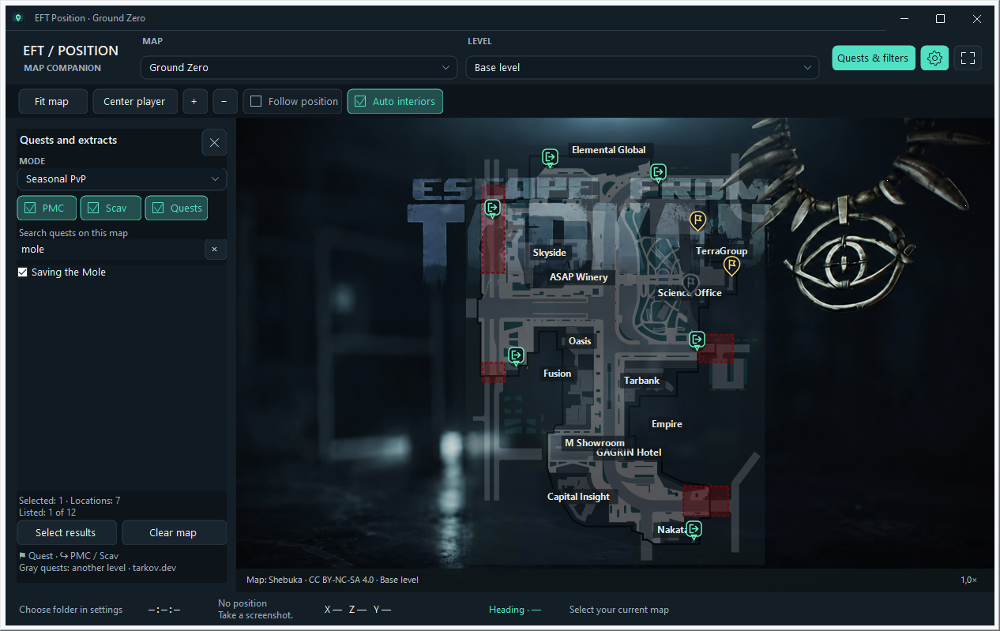

# EFT Position 3.2.0

[English](#english) · [Polski](#polski)

## English

A small Tarkov companion that shows your position on the map. Select a location, take a screenshot in game, and the app displays a marker with your position and viewing direction. Each new screenshot updates the position.

Coordinates are read from the filename. The app does not read the game's memory or logs.

### Download

**[Download version 3.2.0](https://github.com/Joluette/EFT-Map/releases/tag/3.2.0)**

1. Under **Assets**, download **EFT-Position-Windows-3.2.0.zip**.
2. Extract the entire folder and run **EftPosition.exe** or **Uruchom.cmd**. Keep the `assets` and `lib` folders and `EftPosition.exe.config` alongside the app.
3. Select your map, then open settings and choose the folder where EFT saves screenshots. This is usually `Documents\Escape from Tarkov\Screenshots`.
4. Take a screenshot using the game's screenshot feature. Your position should appear on the map.

You need 64-bit Windows with .NET Framework 4.8. Extract the app to a folder it can write to, such as Documents, so it can save your settings. The screenshot folder is remembered for the next launch.

To switch the interface to English, open the gear button, then **Wygląd → Język / Language → English (EN)**. The change applies immediately and is remembered.

To try the app without starting Tarkov, run **Przyklad.cmd**. This is still a test release; [3.1.0](https://github.com/Joluette/EFT-Map/releases/tag/3.1.0) and [3.0.0](https://github.com/Joluette/EFT-Map/releases/tag/3.0.0) remain available.

### Maps and quests

There are 13 maps and 55 levels. Select the map manually. **Auto interiors** tries to adjust the level and zoom after a new screenshot; you can also select a level yourself. Some maps and levels need an internet connection on the first download, then use a cached copy.

Open **Quests & filters** for PMC/Scav extracts and quests. Search quest names in English or Polish, with or without Polish accents, and select several quests at once. The list is limited to your selected map and mode: PvP, PvE or Seasonal PvP. Changing the search does not clear your selections, and your choices are saved for later.

Gold flag pins mark quest locations; green and blue icons mark extracts. Hover an icon to see its name. Quests on another recognized level are dimmed. If the data does not include the target's height, its marker stays at full brightness.

Quest locations are bundled with the app and work offline. Only quests with location data from the source are included; the bundled Terminal dataset is currently empty. A marker may represent a point within an area or one of several possible item spawns. Check extract availability in game during your raid.

### Appearance and language

The gear button opens appearance, window and screenshot settings. Under **Appearance → Język / Language**, choose **Polski (PL)** or **English (EN)**. The interface changes immediately and remembers your choice.

You can change the theme, accent color, background, rounded corners, marker size and map opacity. There are also controls for whole-window transparency and for showing or hiding the bottom position bar. **F10** restores full window visibility. The Tarkov and Tarkov × Cyberpunk (HD) backgrounds were generated with AI using reference images; they are not official artwork or confirmation of a collaboration between these brands.

Panning and zooming large PNG maps, including Labs, Labyrinth and Icebreaker, use the new viewport buffer. Movement uses a fast preview, and the final rendering quality returns when you stop.

### Screenshots

**“Delete screenshot after reading” is enabled by default.** After showing a valid position, the app deletes the recognized PNG while keeping the position marker on the map. You can turn this off under **Settings → Screenshots**; your choice is remembered.

The app does not clear the entire folder. Unrecognized files, screenshots that have not been displayed, and positions outside the selected map are left untouched. If a file is still being written, the app briefly retries deletion. Files that have changed or cannot be accessed are also kept. Demo mode does not delete screenshots.

The folder settings are stored in `cache/app-preferences.json`, and selected quests in `cache/marker-preferences.json`. These personal files are not included in the download.

### Controls

- Mouse wheel or **+ / −** — zoom in and out.
- Drag the map — pan.
- **Fit map** and **Center player** — quickly adjust the view.
- **Follow position** — center after a new screenshot.
- **Quests & filters / Ctrl+F** — open the quest and extract panel.
- **Gear / Ctrl+,** — settings. **F10** — restore full window visibility.
- **F11** — full screen. **Esc / F11** — return.
- Right mouse button — extra options and the time of the latest screenshot.

### Source code

The app is written in C# and WinForms. Get the source from this repository or **EFT-Map-kod-zrodlowy-3.2.0.zip** in the release.

**Zbuduj.cmd** builds the app, and **Testuj.cmd** runs the tests. The compiler supplied with .NET Framework 4.8 is sufficient; the required libraries are already in `lib`. Some tests require a Windows desktop session.

Application code is in `src`, tests in `tests`, and maps and marker data in `assets`. Preparation tools are in `tools`. Updating marker data with `Update-Markers.ps1` requires Node and an internet connection. Changing `VERSION` on `main` triggers the tests and publication of the next release through GitHub Actions.

See [RELEASE-NOTES.md](RELEASE-NOTES.md) for changes and [RAPORT.md](RAPORT.md) for test results and memory measurements. Archive checksums are provided in **SHA256SUMS.txt** with the release.

### Credits and licenses

- Application code — **GPL-3.0-only**.
- Map calibration and data from tarkov.dev — **MIT**.
- Maps by Shebuka — **CC BY-NC-SA 4.0**, with attribution and the restriction to noncommercial use.
- SharpVectors 1.8.5 — **BSD-3-Clause**, with notices for its bundled components.

Quest and extract locations come from the [tarkov.dev JSON API](https://tarkov.dev/api). Sources and checksums for this dataset are recorded in `assets/markers.source.json`. Downloaded tiles retain their authors' separate rights; the tile cache is not included in the package.

Full notices and license texts are in [THIRD-PARTY-NOTICES.md](THIRD-PARTY-NOTICES.md), `licenses` and `lib/dependencies.json`.

---

## Polski

Mała apka do Tarkova, która pokazuje, gdzie jesteś na mapie. Wybierasz lokację, robisz screena w grze i pojawia się znacznik Twojej pozycji oraz kierunku patrzenia. Kolejny screen odświeża pozycję.

Współrzędne są odczytywane z nazwy pliku. Program nie czyta pamięci ani logów gry.

### Pobieranie

**[Pobierz wersję 3.2.0](https://github.com/Joluette/EFT-Map/releases/tag/3.2.0)**

1. W sekcji **Assets** wybierz **EFT-Position-Windows-3.2.0.zip**.
2. Rozpakuj cały folder i uruchom **EftPosition.exe** albo **Uruchom.cmd**. Zostaw obok programu foldery `assets`, `lib` i plik `EftPosition.exe.config`.
3. Wybierz mapę, a w ustawieniach wskaż folder, w którym EFT zapisuje screenshoty. Zwykle jest to `Dokumenty\Escape from Tarkov\Screenshots`.
4. Zrób screena funkcją gry — pozycja powinna pojawić się na mapie.

Potrzebujesz Windowsa 64-bit z .NET Framework 4.8. Rozpakuj aplikację np. do Dokumentów, żeby mogła zapisywać ustawienia. Folder zrzutów zostanie zapamiętany na następne uruchomienie.

Jeśli chcesz najpierw zobaczyć, jak to wygląda, odpal **Przyklad.cmd**. Działa bez włączania Tarkova. To nadal wersja testowa; starsze [3.1.0](https://github.com/Joluette/EFT-Map/releases/tag/3.1.0) i [3.0.0](https://github.com/Joluette/EFT-Map/releases/tag/3.0.0) też są dostępne.

### Mapa i questy

Do wyboru jest 13 map i 55 poziomów. Mapę ustawiasz ręcznie. **Auto wnętrza** próbuje dopasować piętro i zbliżenie po nowym zrzucie; poziom zawsze możesz też wybrać samodzielnie. Część map i pięter potrzebuje internetu przy pierwszym pobraniu, potem korzysta z zapisanej kopii.

Pod **Questy i filtry / Quests & filters** znajdziesz ekstrakty PMC/Scav i questy. Możesz wyszukać nazwę po polsku lub angielsku, bez polskich znaków, i zaznaczyć kilka zadań naraz. Lista dotyczy tylko wybranej mapy i trybu: PvP, PvE albo PvP sezonowego. Zmiana wyszukiwania nie kasuje zaznaczeń, a wybór zostaje zapisany na później.

Złote pinezki z flagą to miejsca questowe, zielone i niebieskie znaczki to wyjścia. Najedź kursorem, żeby zobaczyć nazwę. Questy na innym rozpoznanym piętrze są przyciemnione. Jeśli w danych brakuje wysokości celu, znacznik zostaje w pełnym kolorze.

Punkty questów są dołączone do aplikacji i działają offline. Są tu zadania, dla których źródło podaje lokalizacje — na Terminalu ta baza jest obecnie pusta. Marker może wskazywać punkt obszaru albo jedno z możliwych miejsc pojawienia się przedmiotu. Dostępność ekstraktu w danym rajdzie sprawdzaj w grze.

### Wygląd i język

Pod zębatką są ustawienia wyglądu, okna i zrzutów. W **Wygląd → Język / Language** wybierzesz **Polski (PL)** albo **English (EN)**. Interfejs przełącza się od razu, a wybór zostaje na kolejne uruchomienie.

Możesz zmienić motyw, kolor akcentu, tło, zaokrąglenie kontrolek, rozmiar znaczników i krycie mapy. Są też osobne ustawienia przezroczystości całego okna oraz dolnego paska pozycji. **F10** przywraca pełną widoczność okna. Tła Tarkov i Tarkov × Cyberpunk (HD) są grafikami wygenerowanymi z użyciem AI na podstawie referencji; nie są oficjalnymi materiałami ani potwierdzoną współpracą tych marek.

Przesuwanie i przybliżanie dużych map PNG, w tym Labs, Labiryntu i Icebreakera, korzysta z nowego bufora widoku. Podczas ruchu działa szybki podgląd, a po zatrzymaniu wraca docelowa jakość.

### Zrzuty ekranu

**Opcja „Usuwaj zrzut po odczycie” jest domyślnie włączona.** Po pokazaniu poprawnej pozycji program usuwa odczytany PNG, ale zachowuje znacznik na mapie. Możesz to wyłączyć w **Ustawienia → Zrzuty**; ustawienie zostanie zapamiętane.

Apka nie sprząta całego folderu. Nierozpoznane pliki, zrzuty, których nie pokazano, i pozycje spoza wybranej mapy zostają. Jeśli plik jest jeszcze zapisywany, program przez chwilę ponawia próbę usunięcia. Zmieniony lub niedostępny plik również zostaje. W trybie przykładowym nic nie jest usuwane.

Ustawienia folderu są w `cache/app-preferences.json`, a wybrane questy w `cache/marker-preferences.json`. Nie ma ich w paczce do pobrania.

### Sterowanie

- Kółko myszy lub **+ / −** — przybliżanie i oddalanie.
- Przeciągnięcie mapy — przesuwanie.
- **Cała mapa** i **Do znacznika** — szybki powrót do widoku.
- **Śledź pozycję** — centrowanie po nowym screenie.
- **Questy i filtry / Ctrl+F** — wysuwany panel questów i ekstraktów.
- **Zębatka / Ctrl+,** — ustawienia. **F10** — pełna widoczność okna.
- **F11** — pełny ekran. **Esc / F11** — powrót.
- Prawy przycisk myszy — dodatkowe opcje i czas ostatniego zrzutu.

### Kod źródłowy

Aplikacja jest napisana w C# i WinForms. Kod możesz pobrać z repozytorium albo z paczki **EFT-Map-kod-zrodlowy-3.2.0.zip** w wydaniu.

**Zbuduj.cmd** kompiluje program, a **Testuj.cmd** odpala testy. Wystarczy kompilator z .NET Framework 4.8; biblioteki są już w `lib`. Część testów wymaga sesji pulpitu Windows.

W `src` jest kod aplikacji, w `tests` testy, a w `assets` mapy i dane znaczników. Narzędzia do ich przygotowania są w `tools`. Odświeżenie danych przez `Update-Markers.ps1` wymaga Node i internetu. Zmiana `VERSION` na `main` uruchamia testy i publikację kolejnego wydania przez GitHub Actions.

Szczegóły zmian: [RELEASE-NOTES.md](RELEASE-NOTES.md). Wyniki testów i pomiar pamięci: [RAPORT.md](RAPORT.md). Sumy paczek są w **SHA256SUMS.txt** przy wydaniu.

### Autorzy i licencje

- Kod aplikacji — **GPL-3.0-only**.
- Kalibracja i dane map tarkov.dev — **MIT**.
- Mapy Shebuki — **CC BY-NC-SA 4.0**, z zachowaniem autorstwa i ograniczeniem do użytku niekomercyjnego.
- SharpVectors 1.8.5 — **BSD-3-Clause**, z informacjami o dołączonych składnikach.

Lokalizacje questów i ekstraktów pochodzą z [JSON API tarkov.dev](https://tarkov.dev/api). Źródła i sumy tej bazy znajdziesz w `assets/markers.source.json`. Pobierane kafelki mają osobne prawa autorów; gotowy cache nie jest częścią paczki.

Pełne informacje i teksty licencji: [THIRD-PARTY-NOTICES.md](THIRD-PARTY-NOTICES.md), `licenses` oraz `lib/dependencies.json`.
